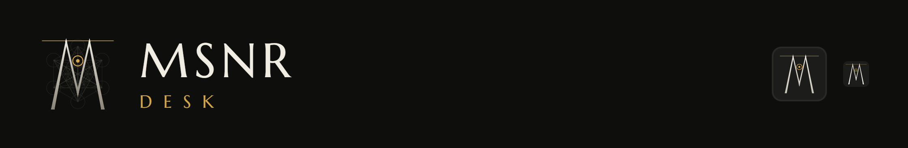
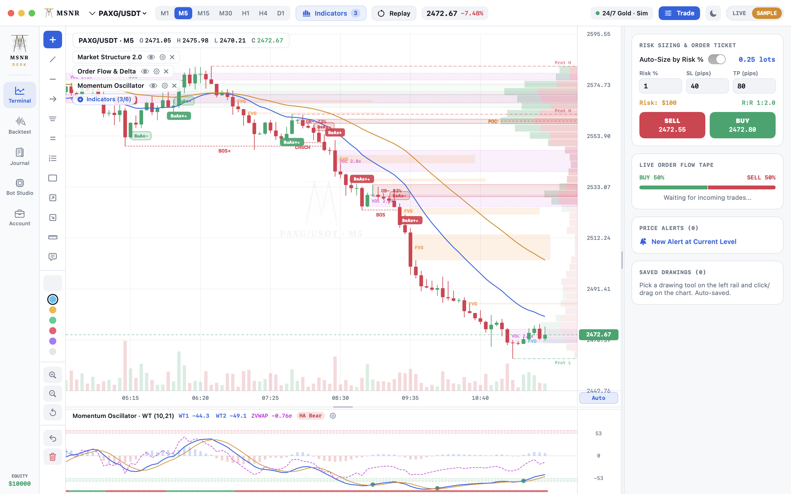
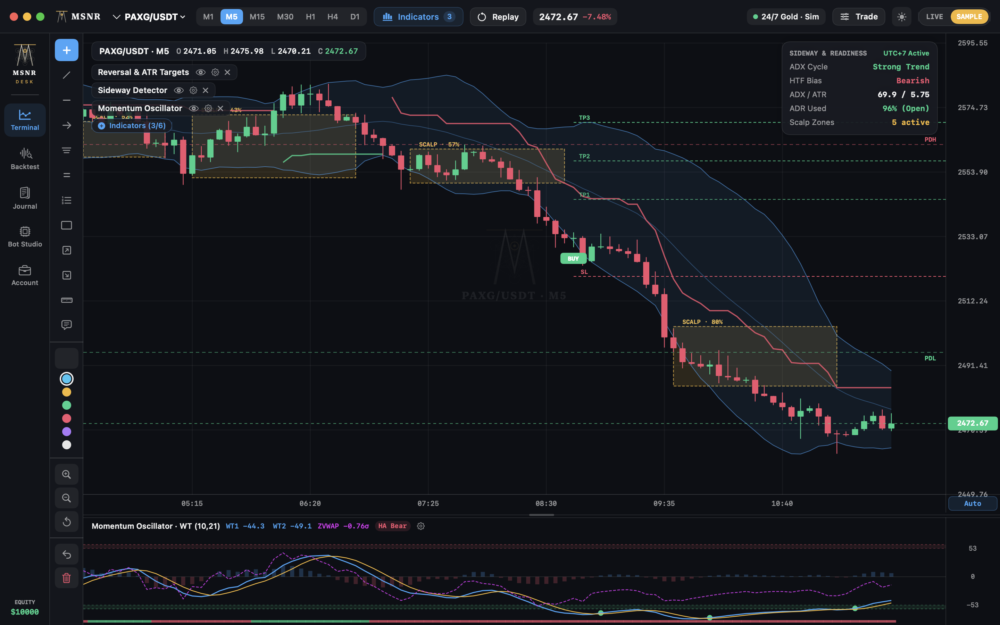
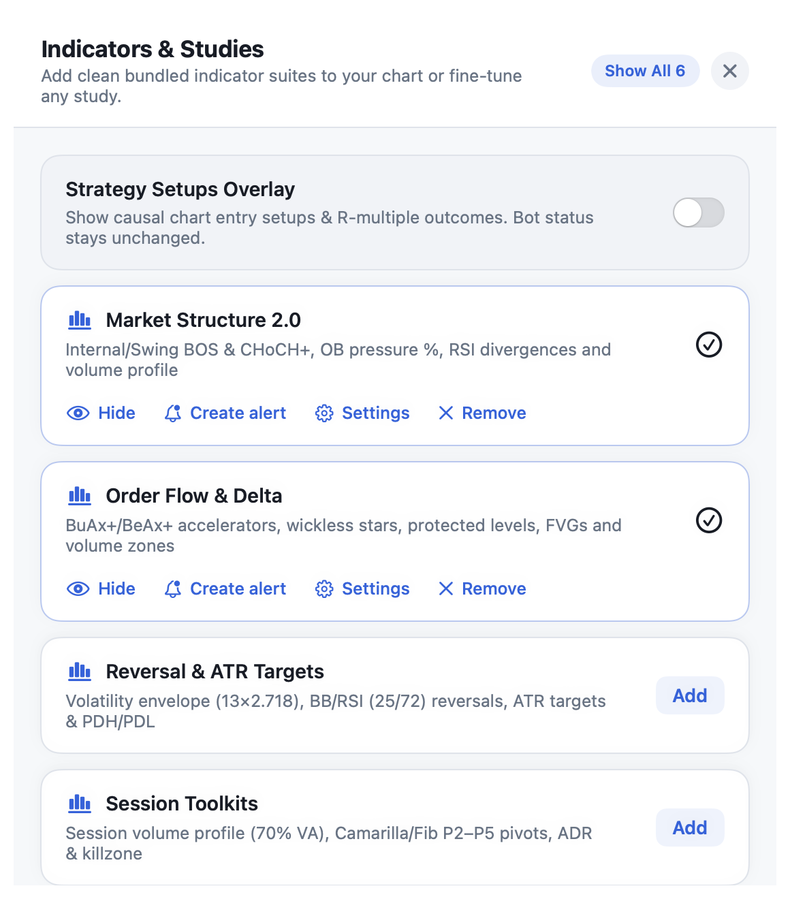
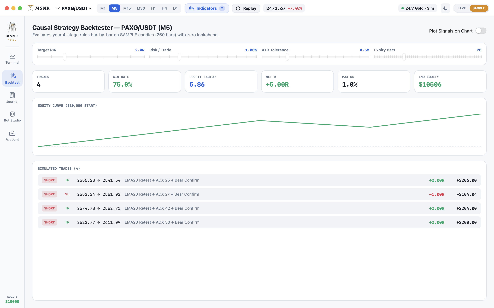

<p align="center">
  
</p>

<h1 align="center">Trading-Lab · MSNR Desk</h1>

<p align="center">
  <strong>Native macOS SwiftUI trading terminal, institutional indicator suite, causal backtester, and paper-trading desk.</strong>
</p>

<p align="center">
  
  
  
  
</p>

---

## Screenshots

### Light Terminal — Market Structure 2.0, Order Flow & Momentum Oscillator
> Dual-tier `BOS`/`CHoCH`/`CHoCH+`, Order Block pressure %, `BuAx+`/`BeAx+` Accelerator candles, Fair Value Gaps, Volume Profile + POC, Risk-Sized Order Ticket, and WaveTrend + ZVWAP + Heikin-Ashi lower pane.



### Dark Terminal — Reversal & ATR Targets + Sideway Detector
> Dynamic Volatility Envelope (`13 × 2.718`), Bollinger/RSI Reversal entries with `SL`/`TP1`/`TP2`/`TP3`, Previous Daily High/Low (`PDH`/`PDL`), live **Scalp Zones**, and the **Sideway & Readiness** dashboard (`ADX Cycle`, `HTF Bias`, `ADR Gate`, `UTC+7 Working Hours`).



### Bundled Indicator Library & Causal Backtest Studio

| Indicator Library (6 Local Suites) | Causal Strategy Backtester |
| :---: | :---: |
|  |  |

---

## Key Features

### Live & Sample Market Data (Zero API Keys Required)
* **24/7 Real-Time WebSocket + Order Flow Tape (Binance)**: `PAXG/USDT` (Gold 24/7), `BTC/USD`, and `ETH/USD` stream live candles and `@aggTrade` buyer/seller aggressor tape.
* **FX, Gold Futures & Indices (Yahoo Finance)**: `XAU/USD` (`GC=F`), `EUR/USD`, `US30`, and `NAS100` with real New York market-hours open/closed detection and session countdowns.
* **Deterministic Sample Mode & Bar Replay**: Practice setups off-hours or step bar-by-bar through historical sessions with variable playback speed.

### 6 Local Indicator Suites
All indicators compute **100% locally in Swift** with zero server dependency and full per-study settings:

1. **Market Structure 2.0** — Internal (`4`) + Macro (`15`) `BOS`/`CHoCH`/`CHoCH+`, Supply/Demand Order Blocks with directional buyer/seller **pressure %**, RSI Regular Divergences, EMAs (`20`/`50`/`200`), and Visible-Range Volume Profile + POC.
2. **Order Flow & Delta** — 4-grade Accelerator candles (`BuAx+`, `BuAx-`, `BeAx+`, `BeAx-`), Wickless `★` stars, Protected Swing Levels (`Prot H`/`Prot L`), Fair Value Gaps (`FVG`), High-Volume Zones (`1.8×+`), and volume histogram.
3. **Reversal & ATR Targets** — Dynamic Volatility Envelope (`13 × 2.718`), Bollinger (`20, 2.0`) + RSI Reversal signals, `2.0× ATR` Stop Loss + `TP1 (1R)` / `TP2 (2R)` / `TP3 (3R)`, and `PDH`/`PDL`.
4. **Session Toolkits** — 70% Value Area Profile, Camarilla & Fibonacci `P2–P5` Pivots (`R2–R5` / `S2–S5`), 5-day ADR, and Killzone readiness.
5. **Sideway Detector** — Automatic **Scalp Zones** (impulse → quiet candles → Order Block directional share), ADX Cycle (`10 / 50 / 30`), 5-day ADR Gate (`50%` open / `100%` danger), and `UTC+7` working hours with cutoff warning.
6. **Momentum Oscillator** *(separate resizable pane)* — WaveTrend (`10, 21`, `±53`/`±60`), Smart Reversal dots, Regular Divergences, dashed **ZVWAP (`20`)** standard-deviation curve, and a **Smoothed Heikin-Ashi Trend Ribbon** (`7`/`10`).

### TradingView-Style Chart Ergonomics

| Action | Control |
|---|---|
| **Horizontal Zoom** | Scroll wheel / trackpad pinch over chart, or drag bottom time axis |
| **Vertical Price Scale** | Drag or scroll on right price axis (double-click axis or click **`Auto`** to reset) |
| **Pan Chart** | Drag on chart canvas (2D pan unlocked when in manual Y-scale) |
| **Resize Panes** | Drag divider between chart & oscillator pane, or between chart & trade drawer |
| **Edit Drawings** | Click any drawing to select → drag handles/body, recolor, duplicate, or `Delete` |
| **Magnet OHLC Snap** | Toggle Magnet icon on left drawing rail |
| **Right-Click Menu** | Instant Price Alert, Horizontal Line, Paper Buy/Sell, or Reset View |
| **Keyboard Shortcuts** | `1`–`7` Timeframes · `⌥T` Trendline · `⌥H` H-Line · `⌥F` Fib · `⌥R` Reset · `⌘Z` Undo · `Esc` Cancel |

### Local Persistence (Never Resets on Reopen)
All workspace state auto-saves locally to `~/Library/Application Support/TradingLab/` with backwards-compatible schema decoding:
* `preferences.json` — Active indicators, all 6 suite settings, instrument, timeframe, `LIVE`/`SAMPLE` mode, Light/Dark theme, zoom, pane sizes, Magnet mode, risk/SL/TP defaults, and paper account balance + open positions.
* `drawings.json` — Per-instrument chart drawings.
* `alerts.json` — Active and triggered price alerts.
* `journal.json` — Trade journal entries with setup & discipline tags.

---

## Build & Run

Requires **macOS 14+** and **Xcode / Swift 5.9+**.

```bash
git clone https://github.com/itsnang/Trading-Lab.git
cd Trading-Lab
./build_app.sh
open build/TradingLab.app
```

To regenerate the documentation screenshots locally:

```bash
./build/TradingLab.app/Contents/MacOS/TradingLab --export-screenshots docs/screenshots
```

---

## Project Structure

```text
TradingLab/
├── Package.swift
├── build_app.sh                      # Release build + macOS .app bundle + AppIcon.icns
├── Resources/
│   └── AppIcon.icns                  # Retina MSNR Desk macOS icon
├── Sources/TradingLab/
│   ├── TradingLabApp.swift           # App lifecycle, frameless window & screenshot exporter
│   ├── Models/                       # Market, Indicator, Drawing & Bot Config models
│   ├── Engine/                       # LiveMarketService, IndicatorEngine, BacktestEngine,
│   │                                 # PersistenceStore & WorkspaceStore
│   └── Views/
│       ├── BrandLogoView.swift       # Adaptive Light/Dark MSNR vector mark
│       ├── Chart/                    # CandlestickCanvasView, OscillatorPaneView, DrawingToolbar
│       └── Panels/                   # IndicatorLibraryView, BacktestView, JournalView,
│                                     # BotStudioView, IndicatorDrawerView, SampleAccountView
└── docs/
    ├── assets/msnr-banner.png
    └── screenshots/
```
