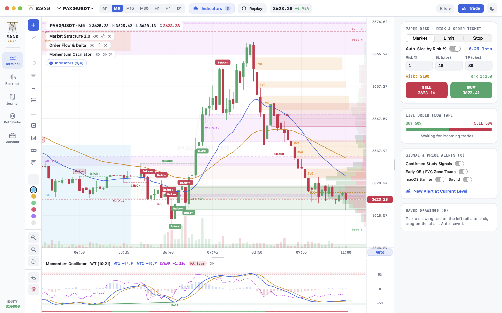
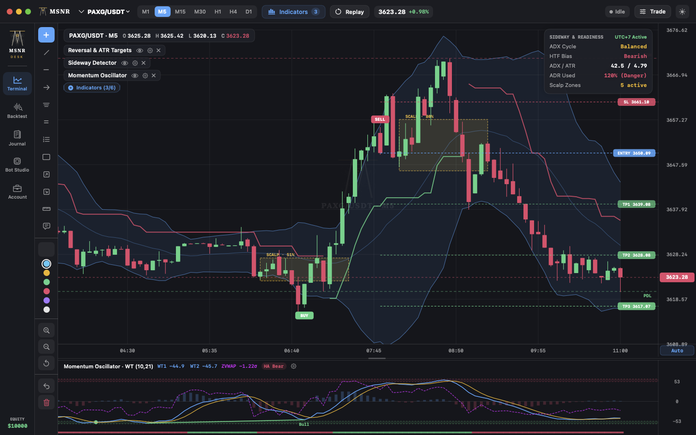
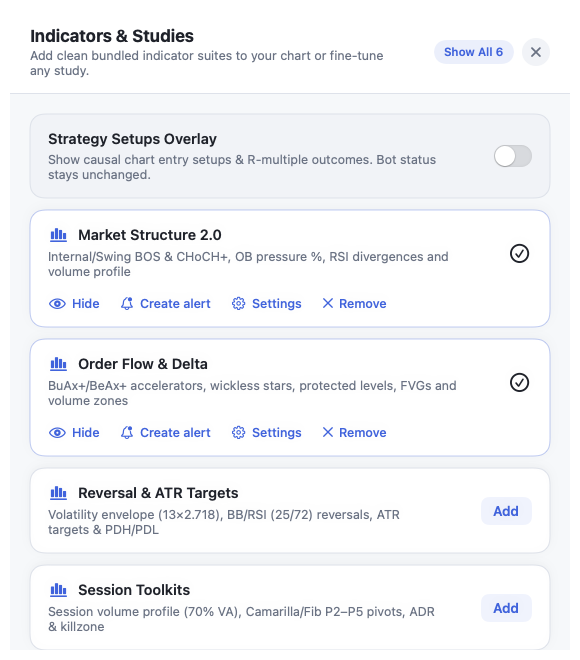
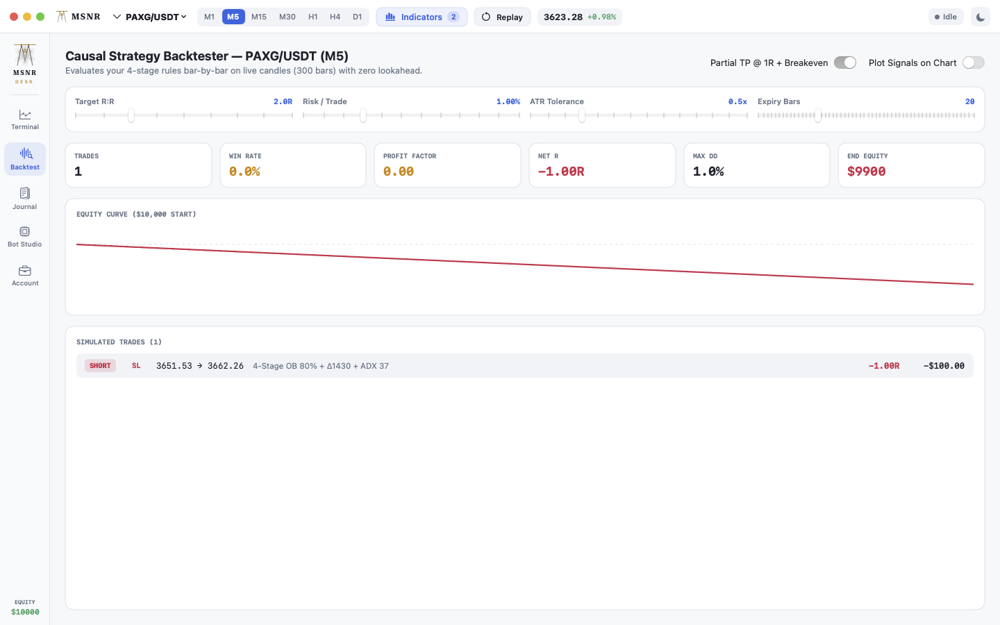

# MSNR Desk — Efficient Trading & Workflow Guide

A practical playbook for getting the most out of **MSNR Desk (`TradingLab.app`)** — from zero-delay chart analysis and pre-move alerts to disciplined Paper Desk execution and strategy validation.

---

## 1. Workspace Layout at a Glance

| Area | What It Does | Efficiency Tip |
|---|---|---|
| **Left Sidebar** | Switch between **Terminal**, **Backtest**, **Journal**, **Bot Studio**, and **Paper Account** | Watch live **EQUITY** at the bottom without leaving the chart |
| **Top Chrome Bar** | Instrument switcher, Timeframe pills (`M1`–`D1`), **Indicators** library, **Replay** mode, Theme toggle, Live Feed pill | Click the **Feed Pill** anytime to force a fresh reconnect |
| **Chart Canvas** | Interactive candlesticks, Study Suites, drawings, alerts, and open/pending Paper Desk lines | Scroll left past bar 35 to auto-load deeper historical candles |
| **Right Drawer** | Collapsible **Paper Desk Order Ticket**, **Live Order Flow Tape**, and **Signal & Price Alerts** | Keep it closed while analyzing (`Order Ticket` button) for a wide chart |


*Light Terminal with Market Structure 2.0, Order Flow & Delta, Momentum Oscillator, Paper Desk (`Market / Limit / Stop`), and Signal & Price Alerts drawer.*

---

## 2. Live Market Feeds & Latency

MSNR Desk runs **100% locally with zero API keys**. Understanding each instrument's feed helps you pick the best chart for your session:

| Instrument | Data Source | Latency | Order Flow Tape | Best Use |
|---|---|---|---|---|
| **XAU/USD** | Real-Time Gold Klines + Swissquote Spot Basis (WS) | **Sub-second** | Yes | Spot Gold intraday & NY/London breakouts |
| **PAXG/USDT** | Binance WebSocket (`PAXGUSDT`) | **Sub-second (24/7)** | Yes | Weekend & 24/7 Gold structure + live tape |
| **BTC/USD, ETH/USD** | Binance WebSocket | **Sub-second (24/7)** | Yes | Crypto scalping & order-flow confirmation |
| **EUR/USD** | Yahoo Historical + Swissquote Spot BBO (1s) | **~0.2s–1s** | — | London/NY FX sessions |
| **US30, NAS100** | Yahoo Finance (`YM=F`, `NQ=F`, 3s poll) | Exchange delay | — | Index structure & swing context |

---

## 3. Fast Navigation & Keyboard Shortcuts

Master these TradingView-style shortcuts to move around the chart without hunting menus:

| Action | Shortcut / Gesture |
|---|---|
| Switch Timeframe (`M1`, `M5`, `M15`, `M30`, `H1`, `H4`, `D1`) | Press **`1`** through **`7`** |
| Trend Line tool | **`Option + T`** |
| Horizontal Level tool | **`Option + H`** |
| Fibonacci Retracement tool | **`Option + F`** |
| Reset Chart Camera (auto-fit & snap to latest bar) | **`Option + R`** |
| Exit drawing tool / Deselect drawing | **`Esc`** |
| Undo last drawing | **`Cmd + Z`** |
| Delete selected drawing | **`Delete`** / **`Backspace`** |
| Zoom X-axis (candles) | Scroll up/down or pinch on trackpad |
| Pan left/right (auto-backfills older history) | Click-drag on chart or two-finger horizontal swipe |
| Manual Y-axis (price) stretch / compress | Drag up/down on the right price axis |
| Snap back to Auto Price Scale | **Double-click** the right price axis |
| Snap drawings to exact candle OHLC | Toggle **Magnet** icon on the drawing toolbar |

---

## 4. Choosing Clean Study Suite Combos

Turning on all 6 Study Suites at once clutters the chart. Instead, use **2–3 complementary suites** depending on your goal:

### A. Clean Discretionary Structure (Default — Best All-Rounder)
- **Market Structure 2.0** (`BOS` / `CHoCH` + Order Blocks + EMA 20/50)
- **Order Flow** (`BuAx+` / `BeAx+` impulse markers + FVGs + Volume Zones)
- **Momentum Oscillator** (lower pane: WaveTrend + divergences)

### B. Signal + Auto Target Levels (Fastest Entry/SL/TP Readout)
- **Reversal & ATR Targets** — plots **`BUY` / `SELL`** badges plus exact color-coded **`ENTRY`**, **`SL`**, **`TP1`**, **`TP2`**, and **`TP3`** price tags on the right edge of the chart.
- **Sideway Detector** — top-right dashboard showing `ADX Cycle`, `HTF Bias`, and `ADR Used %` so you skip dead/choppy ranges.


*Dark Terminal showing a live `SELL` reversal with color-coded `SL`, `ENTRY`, `TP1`, `TP2`, `TP3` price badges and the Sideway & Readiness dashboard.*

### C. Session & Pivot Scalping
- **Toolkits** — Camarilla/Fib pivots (`C-R2`–`R4`, `C-S2`–`S4`) + Session boxes + ADR.
- **Order Flow** — watch for `BuAx+` / `BeAx+` rejection at pivot or session highs/lows.


*Open **Indicators** in the top bar to toggle studies, edit parameters, or create level alerts.*

> **Tip:** Every study's visibility and custom parameters auto-save to disk (`~/Library/Application Support/TradingLab/preferences.json`) and restore automatically on next launch.

---

## 5. Two-Stage Alert Workflow (Catch Moves Early)

Open the **Right Drawer → SIGNAL & PRICE ALERTS** card to configure alerts:

1. **Enable `Early OB / FVG Zone Touch` (Pre-Run Watch)**
   - Fires **before** the impulse move takes off — as soon as live price taps an unmitigated **Order Block** or unfilled **FVG**.
   - Use this as your heads-up to look at the chart and check HTF bias.
2. **Enable `Confirmed Study Signals` (Execution Trigger)**
   - Fires **strictly on candle close** (never repaints mid-bar, never spams duplicates on live ticks, and never fires retroactively when loading history).
   - Covers `BUY`/`SELL` Reversals (with `ENTRY · SL · TP1 · TP2 · TP3`), `CHoCH` / `BOS+`, `BuAx+` / `BeAx+`, WaveTrend crosses, and 4-Stage Strategy setups.
3. **Enable `macOS Banner` + `Sound`**
   - Delivers native macOS Notification Center alerts even when MSNR Desk is in the background.
4. **One-Click `Apply SL/TP`**
   - When a `BUY`/`SELL` signal toast appears at the top (or inside **Recent Signals**), click **`Apply SL/TP`** (or **`Use`**) to copy the signal's exact SL and TP pip distances straight into your Paper Desk order ticket.

---

## 6. Disciplined Paper Desk Execution

Practice execution and risk sizing on live market feeds with zero real-money risk:

1. **Always use Auto Risk Sizing**: Keep **Auto Size by Risk %** enabled (e.g., `1.0%` per trade). Enter your **Stop Loss (pips)** and **Take Profit (pips)** — MSNR Desk calculates the exact lot size automatically.
2. **Use Pending Orders (`Limit` / `Stop`) for Retests**:
   - Instead of chasing candles, switch the ticket from **Market** to **Limit** (for OB/FVG retests) or **Stop** (for breakouts).
   - Pending entry, SL, and TP lines plot directly on the chart and fill automatically when live price touches them.
3. **Active Trade Management (`50%` & `BE`)**:
   - Once price reaches **`+1R`** (or `TP1`), open the **Paper Account** tab (or right drawer) and click **`50%`** to lock in half your profit, then click **`BE`** to move your Stop Loss to breakeven.
   - All SL, TP, breakeven, and partial closes execute automatically on live ticks and log straight into your **Journal** with R-multiple and PnL.

---

## 7. Validating Rules in Backtest Studio

Before trading a setup live, validate it objectively in the **Backtest** tab:

1. Select your target instrument (`XAU/USD`, `PAXG/USDT`, `EUR/USD`) and timeframe (`M5` / `M15`).
2. Scroll left on the chart first if you want a deeper sample size (up to `4,000` bars).
3. Toggle **`Partial TP @ 1R + Breakeven`** and tune **`Target R:R`**, **`Risk / Trade`**, **`ATR Tolerance`**, and **`Expiry Bars`**.
4. Toggle **`Plot Signals on Chart`** to visually audit every entry and exit on the candles — the engine runs **strictly causally (zero lookahead)** with conservative SL-first tie-breaking.


*Backtest Studio with causal 4-stage rule evaluation, `Partial TP @ 1R + Breakeven`, win rate, profit factor, and trade log.*

---

## 8. Recommended 5-Minute Session Routine

1. **Mark HTF Context (`4` / `5` / `6` keys → `M30` / `H1` / `H4`)**: Drop `Option+H` horizontal levels on key highs/lows and check **Sideway Detector** (`HTF Bias` + `ADR Used %`).
2. **Drop to Execution TF (`2` or `3` → `M5` / `M15`)**: Confirm an unmitigated OB or FVG aligned with HTF bias.
3. **Let Alerts Work For You**: Keep `Early OB / FVG Zone Touch` + `Confirmed Study Signals` + `macOS Banner` enabled so you don't stare at every tick.
4. **Execute with Defined Risk**: Click **`Apply SL/TP`** on a confirmed signal (or set a **Limit** order at the OB/FVG) with `1%` risk.
5. **Review in Journal**: At the end of the session, check your **Journal** tab to review win rate, R-multiples, and notes.

---

## 9. Local Data & Quick Troubleshooting

All settings, drawings, alerts, and journal trades are stored locally on your Mac:

```text
~/Library/Application Support/TradingLab/
├── preferences.json   # Theme, studies, indicator settings, alert toggles, Paper Desk state
├── drawings.json      # Per-instrument trendlines, levels, fibs, and notes
├── alerts.json        # Saved manual price alerts
└── journal.json       # Auto-logged & manual trade journal entries
```

- **Wicks look cut off or chart looks squashed**: Double-click the right price axis (or press **`Option + R`**) to reset auto-scale and camera.
- **Feed disconnected after Mac sleep**: Click the **Feed Pill** in the top-right chrome bar to reconnect immediately (Binance WebSocket also auto-reconnects with gap-fill).
- **Backup your workspace**: Copy the `~/Library/Application Support/TradingLab/` folder to preserve all drawings, settings, and journal history.
